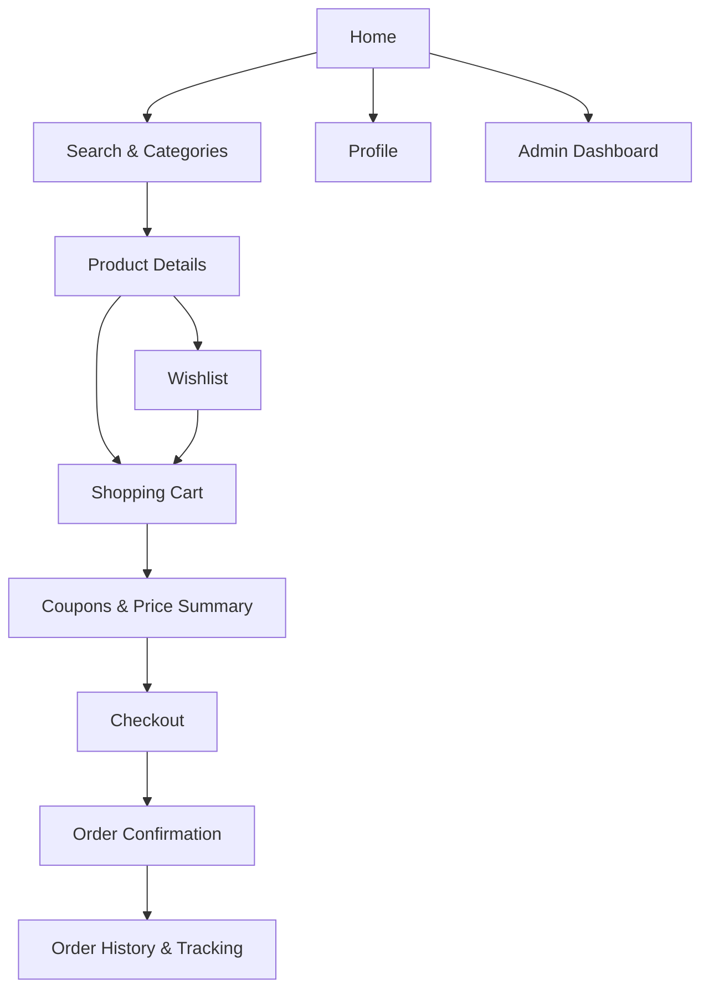

<div align="center">


# ShopSphere

### Everything You Love, Delivered.

A modern e-commerce mobile application built with React Native, Expo and TypeScript.

<p>


</p>

**Discover. Shop. Save. Track.**

</div>

---

## 🛍️ About the Project

**ShopSphere** is a cross-platform mobile shopping application designed to bring essential e-commerce functionality into one intuitive experience.

From discovering products and comparing prices to managing a wishlist, applying discount coupons, and tracking orders, ShopSphere demonstrates how a modern shopping application can be built with a clean user interface and straightforward application architecture.

Developed using React Native and Expo, the project brings together reusable UI components, interactive screens, application state management, navigation, form validation, and on-device data persistence.

> Built as a Cross-Platform App Development project, ShopSphere turns core mobile development concepts into a practical, interactive shopping experience.

## ✨ Features

<table>
<tr>
<td width="50%" valign="top">

### 🏠 Discover & Explore
- Promotional banners and featured collections
- Product categories and new arrivals
- Product search and category filters
- Price filtering and sorting
- Product details, availability and ratings

</td>
<td width="50%" valign="top">

### ❤️ Your Shopping Space
- Personal wishlist
- Shopping cart and quantity management
- Dynamic subtotal and order totals
- Discount coupons
- Delivery charge calculations
- Checkout form validation

</td>
</tr>
<tr>
<td width="50%" valign="top">

### 📦 Orders & Customers
- Simulated checkout and order confirmation
- Order history and order details
- Simulated delivery tracking
- Editable customer profile
- Reviews and product ratings
- Locally stored preferences

</td>
<td width="50%" valign="top">

### ⚙️ Store Management
- Demo admin dashboard
- Product and inventory management
- Order status management
- Basic sales statistics
- Stock validation and cancellation handling
- Local persistence using AsyncStorage

</td>
</tr>
</table>

## 📱 Application Flow

The application is designed around a straightforward shopping journey.



## 🧰 Technology Stack

| Technology | Role |
|---|---|
| React Native | Cross-platform mobile interface |
| Expo | Development tooling and application runtime |
| TypeScript | Type-safe application development |
| React Navigation | Navigation between screens |
| React Hooks | Component state and interactive UI updates |
| AsyncStorage | On-device persistence |
| Flexbox | Responsive interface layouts |
| StyleSheet | Component styling |

## 🏗️ Project Structure

The project keeps related functionality together to make the codebase easier to understand, maintain, and explain.

```text
ShopSphere/
├── assets/
│   └── images/       # Local product and promotional images
├── screens/          # Shopping and account screens
├── App.tsx           # Application setup and navigation
├── index.ts          # Expo entry point
├── catalog.ts        # Product catalogue and sample data
├── store.tsx         # Shared state and persistence
├── ui.tsx            # Reusable UI components
├── utils.ts          # Shared calculations and helpers
├── app.json          # Expo configuration
├── package.json      # Dependencies and scripts
├── package-lock.json # Locked dependency versions
└── README.md
```

### Architecture at a glance

- **Screens** handle the different areas of the shopping experience.
- **Reusable UI components** maintain consistent styling and interactions.
- **Shared store** manages cart, wishlist, order and related application state.
- **Catalogue data** provides the initial products and sample information.
- **Utility functions** centralize calculations and common validation logic.
- **AsyncStorage** preserves supported user and shopping data locally.

## 🚀 Getting Started

### Prerequisites

- Node.js compatible with the project's Expo SDK
- npm
- Android Studio with an Android emulator, or a compatible mobile device

### 1. Clone the repository

```bash
git clone <YOUR_GITHUB_REPOSITORY_URL>
cd ShopSphere
```

Replace `<YOUR_GITHUB_REPOSITORY_URL>` with your repository's actual clone URL.

### 2. Install dependencies

```bash
npm ci
```

The project includes `package-lock.json` to support reproducible dependency installation.

### 3. Start the application

```bash
npx expo start
```

To launch on your running Android emulator, press **`a`** in the Expo terminal.

Alternatively, scan the displayed QR code with a compatible Expo Go installation.

### 4. Run the TypeScript check

```bash
npm run typecheck
```

## 🎟️ Try the Demo Coupons

ShopSphere includes sample coupon codes for demonstrating discount and delivery calculations.

| Coupon | Offer |
|---|---|
| `WELCOME20` | 20% off, capped at ₹800 |
| `SAVE10` | 10% off |
| `FREESHIP` | Free delivery |

The standard delivery fee is ₹49 for eligible orders below ₹999. Orders meeting the free-delivery threshold receive free delivery, and the `FREESHIP` coupon removes the delivery charge.

Discount eligibility and final totals are calculated by the application's shopping logic.

## ✅ Development & Testing

The latest development pass included:

- TypeScript validation — passed.
- Expo Doctor — passed all 20 checks.
- Android emulator testing — primary shopping flows exercised.
- Cart and inventory checks — order cancellation, stock restoration, and product removal verified.
- Coupon validation — `WELCOME20`, `SAVE10`, and `FREESHIP` tested.
- Product reviews — submission, display, and aggregate rating behavior checked.
- Checkout — cart reconciliation and order placement tested.

These results describe the latest reported development pass and are not a guarantee that every possible device configuration is defect-free.

## ⚠️ Scope & Limitations

ShopSphere is an academic e-commerce prototype, not a production commerce platform.

- **Product catalogue:** Uses seeded sample data and local product assets.
- **Persistence:** Supported application data is stored on-device using AsyncStorage.
- **Payments:** Payment methods and transactions are simulated; no real payment is processed.
- **Orders:** Order history and delivery tracking use local demo data.
- **Customer support:** Messages are stored locally and are not sent to an external support team.
- **Notifications:** Preference switches do not send real push notifications or emails.
- **Administration:** The admin dashboard demonstrates management workflows but does not provide production-grade authentication.
- **Backend:** No live backend or remote database is connected.

These limitations keep the project focused on demonstrating mobile application development concepts while leaving clear opportunities for future expansion.

## 🔮 Future Enhancements

Potential next steps include:

- Backend API and database integration
- Customer authentication and protected admin access
- Real payment gateway integration
- Cloud-synchronised carts, wishlists and orders
- Push notifications and order updates
- Automated unit and integration tests
- Product recommendations and personalised shopping

## 🎓 Learning Outcomes

Developing ShopSphere provided practical experience with:

- Functional components and Props
- React Hooks and state management
- Reusable components and project organization
- React Native core components
- Flexbox and responsive layouts
- Multi-screen navigation
- Search, filtering and event handling
- Form validation and pricing calculations
- Persistent local application state
- Interactive shopping workflows

## 📄 License

This project was created for academic and demonstration purposes. No open-source license has been specified.

---

<div align="center">

### ShopSphere

**Shop Smarter. Live Better.**

Built with React Native, Expo and TypeScript.

</div>
